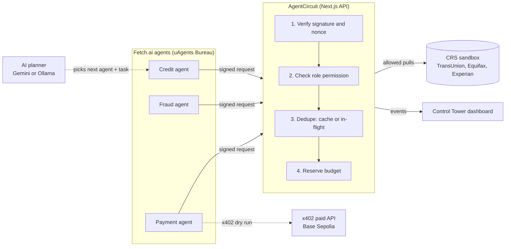

# AgentCircuit

**Air traffic control for AI agents.** Many agents, one coordinated system.

AgentCircuit is a control layer between autonomous AI agents and sensitive resources. Before any agent touches credit data or a paid API, AgentCircuit verifies who it is, checks what it may do, reuses work that was already done, and charges the request against a shared budget.

The demo is a small lending team of three [Fetch.ai](https://fetch.ai) agents (Credit, Fraud, Payment) working against the CRS credit-bureau sandbox. An LLM (Gemini or a local Ollama model) decides which agent acts next. **AgentCircuit decides whether it is allowed.**

Built for Cal Hacks 13.0.

> Only CRS sandbox **test personas** are used. No real personal data is sent or stored. x402 runs as a **dry run**: no wallet signs and no money moves.

## What it does

| Control | How it works |
|---|---|
| Verified identity | Each agent signs its request with its uAgent secp256k1 key. The server checks signature, timestamp (±2 min) and a single-use nonce, then takes the role from its own registry, never from the request body. |
| Permissions | Credit and Fraud may read credit reports. Payment may not, so its attempt is blocked and logged. |
| Deduplication | Pulls are keyed by `persona:bureau`. A repeat request reuses the cached result; a concurrent one joins the pull in flight. |
| Budget | Each pull reserves its cost before the call. Concurrent agents cannot jointly overshoot; a failed pull refunds its reservation. |
| Data minimization | Agents receive a summary (file status, scores, error codes, request ID), never the raw CRS file. |
| Underwriting policy | Deceased flags, security freezes, scores below 660 and bureaus disagreeing by more than 50 points produce APPROVE, REVIEW or DECLINE with every reason listed. |
| x402 spending guard | The Payment agent reads a real HTTP 402 `PAYMENT-REQUIRED` challenge and checks network (Base Sepolia), recipient and price against its limit, without signing. |
| AI routing | The model returns `next_agent`, `task` and `reason` from a fixed allowlist. It never grants access. |

## Architecture



Default demo run: Credit pulls the P01 TransUnion report (**ALLOW**), the AI routes to Fraud whose identical request is served from cache (**REUSE**), then routes to Payment whose attempt to read the report is **BLOCKED**.

## Project layout

```
app/control/            Control Tower dashboard (/control) and x402 Payments Lab (/control/x402)
app/api/control/        Control API: agent-request, agents, state, activity, ai-plan, run-agents, x402, ...
lib/control/            Signature verification, identity, permissions + dedupe + budget, policy, store
lib/crs/                Server-side CRS client and sandbox persona fixtures
fetch_agents/           Python uAgents; ai_coordinated_agents.py is the main workflow,
                        asi_gateway_agent.py is an ASI:One chat gateway (see asi_gateway_README.md)
scripts/                x402 inspection / testnet payment script
tests/                  x402 policy tests
docs/                   Original idea notes and historical patch notes
```

## Setup

Requirements: Node.js 20+, Python 3.13, and either a Gemini API key or [Ollama](https://ollama.com) running locally.

```bash
# 1. Web app
npm install
cp .env.example .env.local      # then fill in the values

# 2. Python agents (the dashboard launches .venv-fetch, so keep that name)
python -m venv .venv-fetch
.venv-fetch\Scripts\python.exe -m pip install -r requirements.txt     # Windows
# .venv-fetch/bin/python -m pip install -r requirements.txt           # macOS / Linux

# 3. Optional: local model instead of Gemini
ollama pull qwen3:1.7b
```

### Environment variables

See [.env.example](.env.example). The essentials:

| Variable | Purpose |
|---|---|
| `CRS_USERNAME`, `CRS_PASSWORD` | CRS sandbox login, used only on the server |
| `AGENTCIRCUIT_AGENT_TOKEN` | Operator token the agents use to enroll their addresses |
| `CREDIT_AGENT_SEED_PHRASE`, `FRAUD_AGENT_SEED_PHRASE`, `AGENT_SEED_PHRASE` | uAgent identity seeds for Credit, Fraud and Payment |
| `GEMINI_API_KEY` | Uses Gemini when set; otherwise Ollama |
| `X402_PAY_TO` | Base Sepolia address you control; without it the x402 API returns 503 |

## Run

```bash
npm run dev
```

Open <http://localhost:3000/control>, choose a model and a scenario in **Run AI Agents**, and press Run. The dashboard starts the agents, which enroll themselves and run the workflow. Scenarios include credit only, fraud review, the payment access test, and x402 dry runs within and over budget.

To run the agents from a terminal instead:

```bash
.venv-fetch\Scripts\python.exe fetch_agents\ai_coordinated_agents.py
```

The goal can be set with `AGENTCIRCUIT_DEMO_GOAL`, for example `"Investigate possible fraud in the P01 TransUnion credit report, then test whether the payment agent can access it."`

Sandbox personas available: P01, P13, P14, P15, P17.

### Tests

```bash
npm test
```

## Public deployment (Vercel)

Vercel cannot host the always-on Python uAgents Bureau, and AgentCircuit's state lives in memory, so a deployed build runs in **Recorded Demo** mode. `/control` replays workflows captured from a real local run (`lib/control/recorded-demo.json`) and labels them as recorded. No agent, AI model or CRS call runs on the deployment.

| Route on a deployed build | Behavior |
|---|---|
| `GET /api/control/demo`, `GET /api/control/personas`, `GET /api/control/state` | Served (read-only, no secrets) |
| `POST /api/control/x402/policy` | Served (pure policy preview on fixed inputs, no state change) |
| `GET /api/control/x402/report` | Served; returns the real HTTP 402 challenge when `X402_PAY_TO` is set |
| Signed agent APIs, `run-agents`, `ai-provider`, `activity`, `scenario`, `/api/crs/credit` | Local development only (404/403) |

Vercel settings: Next.js preset, default build, output and install commands. The only environment variable the deployment uses is `X402_PAY_TO` (for the Payments Lab). Do **not** add CRS credentials, seed phrases, the agent token, `GEMINI_API_KEY` or `X402_BUYER_PRIVATE_KEY`: nothing on the deployment reads them.

To refresh the recording, run the local stack and then:

```bash
node scripts/record-demo.mjs --provider=gemini   # or --provider=ollama
```

It drives the same APIs as the dashboard, keeps only runs that reach `WORKFLOW COMPLETE`, and redacts `.env.local` credentials and local paths. Add `--only=<scenario id>` (for example `--only=x402-block-budget`) to re-record one scenario and keep the others.

## Safety notes

- This is a local demo. Most control API routes, including agent requests and enrollment, refuse to run outside `next dev` until deployment security is in place.
- State (registry, cache, nonces, budget) lives in memory and resets when the server restarts.
- The x402 resource is a synthetic report, not CRS data. Real testnet settlement exists only in `scripts/x402-payment-agent.mjs --pay` and requires `X402_ENABLE_TESTNET_PAYMENT=YES` plus a dedicated test wallet.

## Built with

Fetch.ai uAgents · Python · httpx · Next.js 16 · React 19 · TypeScript · Tailwind CSS · CRS Credit API (sandbox) · x402 · Base Sepolia · Gemini · Ollama
